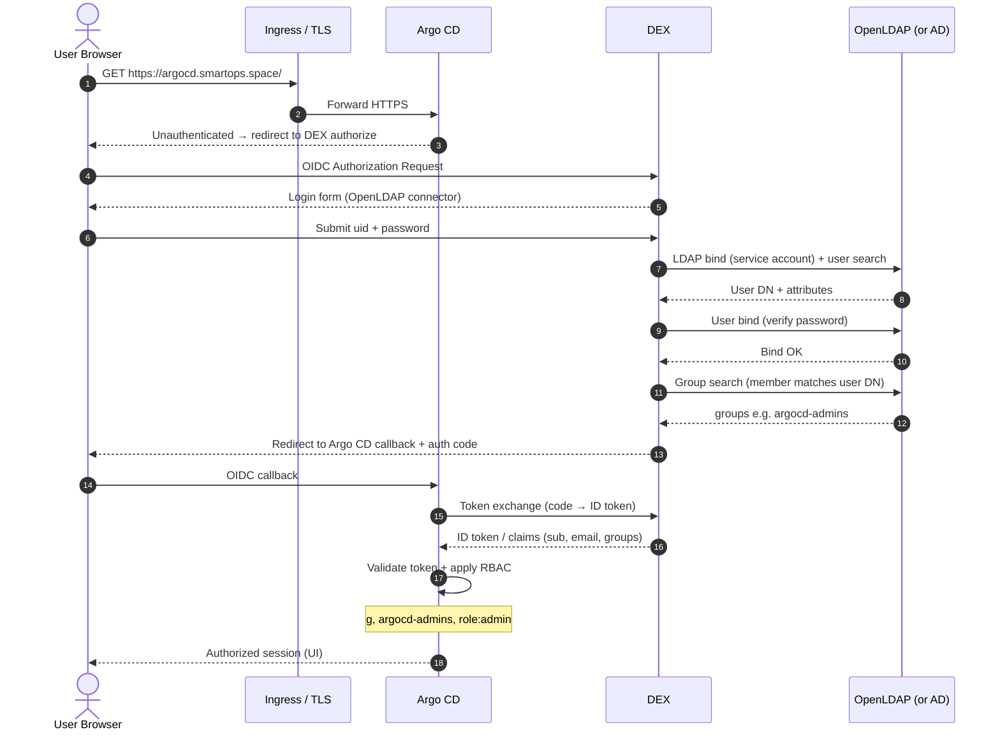
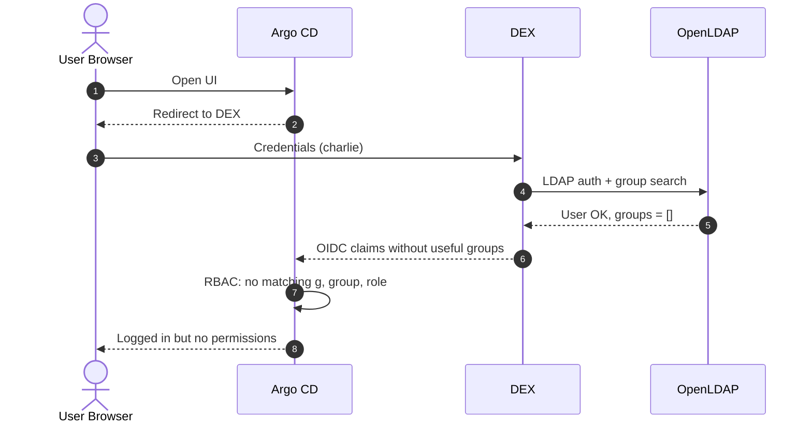

# Production-style sequence flow — OpenLDAP + DEX + Argo CD

Lab substitute for AD: **OpenLDAP** stores users/groups. Protocols and order are the same as production AD.

## Topology (production-style)

```
Internet
   │ HTTPS (443)
   ▼
Ingress / Load Balancer (Traefik + GCP NLB + TLS)
   │
   ▼
Argo CD Server  ──OIDC──►  DEX  ──LDAP/LDAPS──►  Directory (OpenLDAP / AD)
   │                         │
   │                         └── returns identity + groups as OIDC claims
   ▼
Argo CD RBAC (policy.csv) → allow / deny actions
```

**Boundaries**
- Argo CD does **not** speak LDAP to the directory.
- The directory does **not** speak OIDC to Argo CD.
- DEX is the identity broker / translator.

## Sequence — successful login (alice → admin)



## Sequence — auth OK, authorization denied (charlie)



This is **authorization failure**, not authentication failure.

## Protocol map

| Hop | Protocol | Purpose |
|---|---|---|
| Browser → Ingress → Argo CD | HTTPS | App access |
| Argo CD ↔ DEX | OIDC (authorize, token, JWKS) | App login + identity tokens |
| DEX → OpenLDAP / AD | LDAP 389 or LDAPS 636 | Bind, search user, search groups |
| Inside Argo CD | RBAC (`scopes: [groups]`) | Map LDAP/AD groups to roles |

## Claims → RBAC (lab)

| LDAP / AD group CN | OIDC claim | Argo CD mapping |
|---|---|---|
| `argocd-admins` | `groups` | `g, argocd-admins, role:admin` |
| `argocd-readonly` | `groups` | `g, argocd-readonly, role:readonly` |
| *(none)* | `groups` empty | authenticated, no access |

## Production hardening checklist

1. **Directory:** HA Domain Controllers or HA OpenLDAP; LDAPS only; least-privilege bind DN.
2. **DEX:** HA replicas; secrets in Kubernetes Secret / external secret store; no plain LDAP on untrusted networks.
3. **Argo CD:** external URL + correct OIDC issuer; disable or tightly control local `admin`; RBAC deny-by-default.
4. **Edge:** TLS certs (Let's Encrypt or enterprise PKI), WAF/rate limits as required.
5. **Ops:** audit login failures (DEX + Argo CD logs), alert on directory connectivity, rotate bind password.
6. **Cutover AD:** change DEX host/bind/filters (`userPrincipalName`, `memberOf`, `:636`); keep OIDC + RBAC unchanged.

## One-line memory

`User --HTTPS--> Argo CD --OIDC--> DEX --LDAPS--> Directory → claims → Argo CD RBAC`
